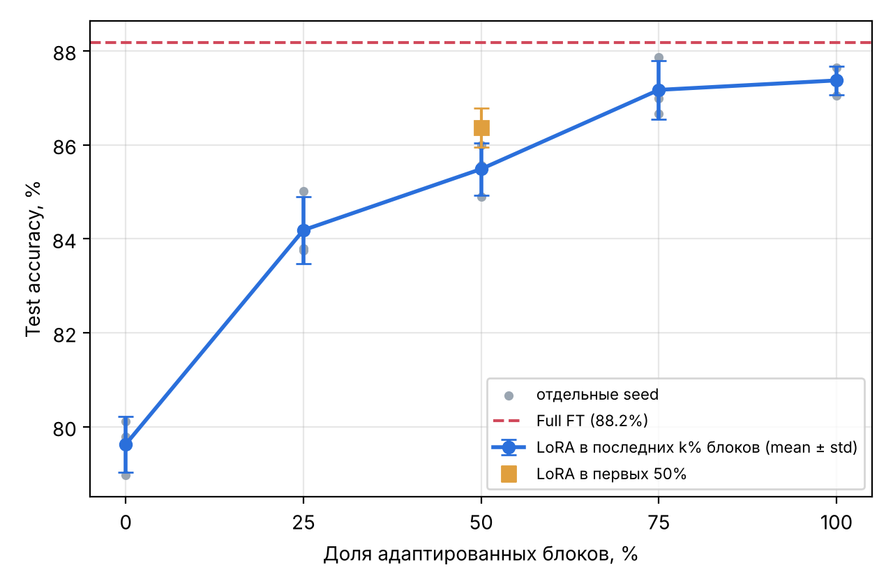

# Сколько Transformer-блоков адаптировать LoRA

Проект проектной практики НИЯУ МИФИ. Вопрос: нужно ли ставить LoRA во **все** блоки трансформера,
или хватает последних 25 / 50 / 75 % блоков? Модель BERT-medium (8 блоков, 41,4M параметров), задача SST-2,
LoRA r=8 через `layers_to_transform` в PEFT, 7 вариантов × 3 seed.

**Команда:** Волков Даниил (Б25-511), Шляхов Антон (Б25-521), Сивцев Эдуард (Б25-511), Мирчу Евгений (Б25-511).

## Результаты

Google Colab, Tesla T4; test accuracy, среднее ± std по 3 seed.

| Вариант | Test acc, % | Trainable | % от модели | Время, с |
|---|---|---|---|---|
| Head only (0%) | 79,6 ± 0,6 | 263 682 | 0,64 | 29 |
| LoRA last 25% | 84,2 ± 0,7 | 411 138 | 0,99 | 38 |
| LoRA last 50% | 85,5 ± 0,6 | 558 594 | 1,35 | 45 |
| LoRA last 75% | 87,2 ± 0,6 | 706 050 | 1,71 | 57 |
| LoRA 100% | 87,4 ± 0,3 | 853 506 | 2,06 | 67 |
| LoRA first 50% | 86,4 ± 0,4 | 558 594 | 1,35 | 59 |
| Full fine-tuning | 88,2 ± 0,3 | 41 374 210 | 100 | 75 |



Главное: 25% блоков дают 59% прироста от LoRA, плато с 75% (75→100% даёт +0,2 п.п., меньше std),
LoRA в первых 50% блоков не хуже, чем в последних 50%. Подробно — [report/report.pdf](report/report.pdf).

## Структура репозитория

| Путь | Что это |
|---|---|
| `lora_depth.py` | один запуск: данные → модель с LoRA → обучение → метрики → строка в CSV |
| `run_all.sh` | вся сетка эксперимента (21 запуск) |
| `analyze.py` | агрегация по seed, графики, `results_table.tex` и `numbers.tex` для отчёта |
| `lora_depth_colab.ipynb` | весь эксперимент пошагово в Colab, самодостаточный |
| `results/` | основной прогон (Colab, T4): `results.csv` с метриками и историей по эпохам, `log.txt` |
| `figures/` | графики и сводная таблица по основному прогону |
| `results_cpu_control/` | контрольный прогон того же кода на CPU (4 ядра Xeon) для сверки, расхождение ≤ 0,5 п.п. |
| `report/` | отчёт: `report.tex` (компилируется pdfLaTeX из этой папки), `report.pdf` |
| `presentation/` | презентация для предзащиты |

В `results/results.csv` колонка `trainable_pct` записана старой версией скрипта (знаменатель включал LoRA-матрицы
и копии головы). `analyze.py` пересчитывает долю от размера исходной модели (41 374 210), в таблицах выше и в отчёте уже правильные значения.

---

## План проекта: что, где и как

| # | Этап | Что делаем | Где | Чем / какой файл | Результат |
|---|------|-----------|-----|------------------|-----------|
| 1 | Постановка | Формулируем вопрос, гипотезу, выбираем baseline | отчёт | `report/report.tex`, разделы 1–3 | вопрос + гипотеза |
| 2 | Среда | Ставим Python-пакеты | ноутбук/Colab/сервер | `requirements.txt` | работающее окружение |
| 3 | Модель | Берём BERT-medium (8 блоков, 41,4M) с Hugging Face | автоматически при запуске | `lora_depth.py`, `--model` | предобученные веса |
| 4 | Данные | Скачиваем SST-2 (train 6920 / dev 872 / test 1821) | автоматически в `data/sst2/` | `lora_depth.py`, функция `load_sst2` | 3 tsv-файла |
| 5 | Конфиги LoRA | Ставим LoRA r=8 только в выбранные блоки через `layers_to_transform` | — | `lora_depth.py`, функция `build_model` | 7 вариантов модели |
| 6 | Обучение | 3 эпохи AdamW, выбор эпохи по dev, оценка на test | CPU (~3 ч) или GPU Colab (~20 мин) | `run_all.sh` → 21 запуск | `results/results.csv` |
| 7 | Метрики | test/dev accuracy, trainable params, время | — | пишутся в CSV каждым запуском | по строке на запуск |
| 8 | Анализ | Среднее ± std по 3 seed, графики | локально | `analyze.py` | `figures/*.png`, `summary.csv` |
| 9 | Отчёт | Вставляем таблицы и графики, пишем анализ и выводы | LaTeX (Overleaf) | `report/report.tex` | PDF для предзащиты |

### Варианты эксперимента (этап 5–6)

| Вариант | Какие блоки с LoRA (из 0..7) | Зачем |
|---|---|---|
| Head only | ни одного (backbone заморожен) | нижний baseline: «без адаптации блоков» |
| LoRA last 25% | 6–7 | изучаемый фактор |
| LoRA last 50% | 4–7 | изучаемый фактор |
| LoRA last 75% | 2–7 | изучаемый фактор |
| LoRA 100% | 0–7 | стандартная LoRA, baseline внутри серии |
| LoRA first 50% | 0–3 | контроль: важна ли **позиция** блоков при том же числе параметров |
| Full fine-tuning | все веса | верхний ориентир |

Каждый вариант × seed 0, 1, 2 = 21 запуск. Seed нужны, чтобы отличить эффект от шума.

---

## Как запустить

```bash
pip install -r requirements.txt

# один запуск (проверка, что всё работает)
python lora_depth.py --mode lora --fraction 0.5 --seed 0 --out results/check.csv

# вся сетка (21 запуск)
bash run_all.sh

# таблица + графики
python analyze.py --csv results/results.csv --out figures
```

Или открыть `lora_depth_colab.ipynb` в Google Colab (GPU T4) и выполнить ячейки по порядку. Ноутбук самодостаточный: весь код записывается в файлы ячейками `%%writefile`, клонировать ничего не нужно. В конце он скачивает архив с `results/` и `figures/`.

Основные аргументы `lora_depth.py`:

| Аргумент | По умолчанию | Смысл |
|---|---|---|
| `--mode` | `lora` | `head` — только голова, `lora` — LoRA, `full` — полный fine-tuning |
| `--fraction` | `1.0` | доля блоков с LoRA (0.25 / 0.5 / 0.75 / 1.0) |
| `--position` | `last` | брать последние или первые блоки |
| `--rank`, `--alpha` | 8, 16 | параметры LoRA |
| `--lr` | 5e-4 (LoRA/head), 5e-5 (full) | learning rate |
| `--epochs`, `--batch_size`, `--max_len` | 3, 32, 64 | обучение |
| `--seed` | 0 | seed |

## Среда

Основной прогон: Google Colab, GPU NVIDIA Tesla T4; Python 3.13.16, torch 2.14.1+cu130, transformers 5.24.1, peft 0.22.0.
Контрольный: CPU Intel Xeon 2.3 GHz, 4 ядра; Python 3.13.18, torch 2.15.0, transformers 5.24.1, peft 0.22.0 (`requirements.txt`).
На другом железе результаты совпадут не до знака (недетерминированные CUDA-ядра, другой RNG), средние по seed — в пределах std.
